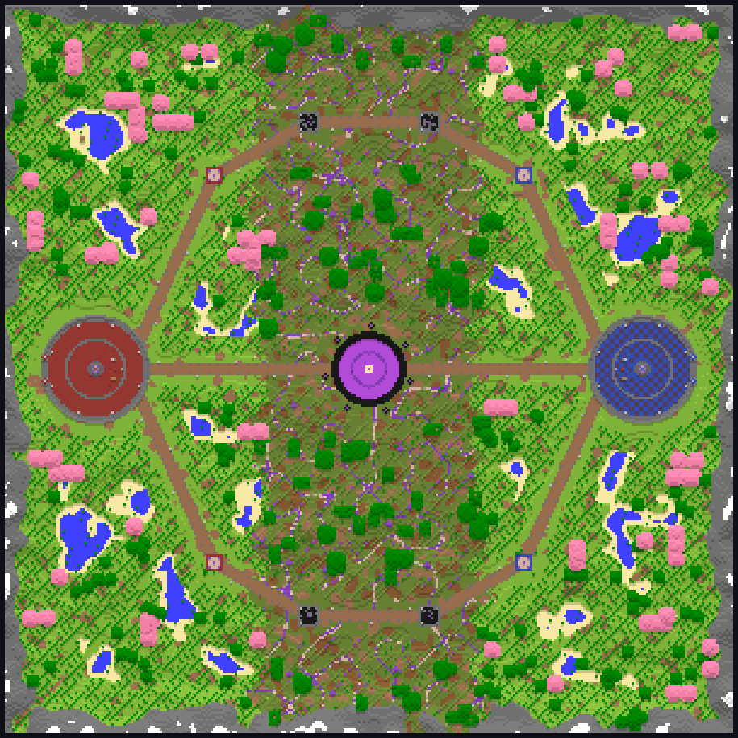

# 3vs3 Aether War

친구 5~6명이 90분 동안 하는 마인크래프트 팀전 미니게임이에요. 두 팀이 균열에서 나오는 **에테르 결정**을 모아 자기 팀 코어를 먼저 1,000까지 채우면 이겨요. PvP를 못해도 채굴, 운반, 점령, 수호자 사냥으로 팀 점수의 절반 이상을 만들 수 있게 설계했어요.

- 서버: **Paper 1.21.4** (Java 21)
- 기획서: https://claude.ai/artifact/LBey2sVjwqcsdnzbuHB7jP



## 서버 여는 법

1. [Paper 1.21.4](https://papermc.io/downloads/paper)를 받아 서버를 한 번 실행해요.
2. `release/AetherWar-0.1.0.jar`를 서버의 `plugins` 폴더에 넣어요.
3. 맵: `maps/aether_arena.zip`의 압축을 서버 폴더(= `server.properties`가 있는 곳)에 풀어서 `aether_arena` 폴더가 생기게 해요.
   - 직접 짓고 싶으면 압축을 풀지 말고, 서버에서 OP로 `/aw buildmap` 을 입력하면 1분 안에 같은 맵이 지어져요.
4. 서버를 켜면 리소스팩이 자동으로 적용돼요(저장소의 `resourcepack/AetherWar-pack.zip`을 GitHub에서 받아요).

## 경기 진행

| 명령어 | 설명 |
| --- | --- |
| `/aw team red` · `/aw team blue` | 팀 고르기 (안 고르면 시작할 때 자동 배정) |
| `/aw start` | 경기 시작 (OP) |
| `/aw stop` | 경기 중단 (OP) |
| `/aw status` | 상태 보기 |
| `/aw tp red` | 기지로 이동 (OP) |
| `/aw skip` · `/aw time <분>` | 테스트용 시간 조작 (OP) |
| `/aw render` | 맵을 위에서 본 이미지로 저장 (OP) |
| `/aw setup ...` | 직접 지은 맵에 기지, 코어, 노드 좌표 지정 (OP) |

### 규칙 요약

| 페이즈 | 시간 | PvP | 내용 |
| --- | --- | --- | --- |
| 1. 탐험 | 0~30분 | 꺼짐 | 자기 팀 안전 노드 채굴, 납품 |
| 2. 확장 | 30~60분 | 중립 지역만 | 점령 노드 점령(8초 서 있기), 35·45·55분 균열 폭주와 수호자 |
| 3. 결전 | 60~90분 | 전 지역 | 적 코어를 때려 약탈 (최대 20%, 이후 60초 보호막), 80분 대균열 개방(결정 2배) |

- 자수정 블록(균열 노드)을 3번 치면 결정 1개. 노드는 20초 뒤 다시 생겨요.
- 결정을 들고 자기 코어 4칸 안에 들어가면 자동 납품 (1개 = 5 에테르).
- 죽으면 들고 있던 결정 절반만 떨구고 10초 뒤 부활. 자기 기지 안에서는 받는 피해 30% 감소.
- 인원이 적은 팀은 납품 +25%.
- 모든 수치는 `plugins/AetherWar/config.yml`에서 바꾸고 `/aw reload`.

## 개발

```bash
./gradlew build                       # build/libs/AetherWar-0.1.0.jar
python3 tools/build_resourcepack.py   # resourcepack/AetherWar-pack.zip 다시 만들기 (Pillow, numpy, ffmpeg 필요)
```

리소스팩 내용: 에테르 결정 아이템 모델, 보스바(팀 색 그라데이션), HUD 아이콘 폰트, 효과음 8종(납품, 채굴, 페이즈, 균열 폭주, 점령, 승리, 대균열, 코어 피격).

## 다음 단계

- 직업 4종과 조합형 스킬트리 GUI (갈림길, 교차 스킬, 균열 각인, 팀 콤보, 재분배)
- 정제 결정, 포탑, 함정 등 직업 전용 아이템
